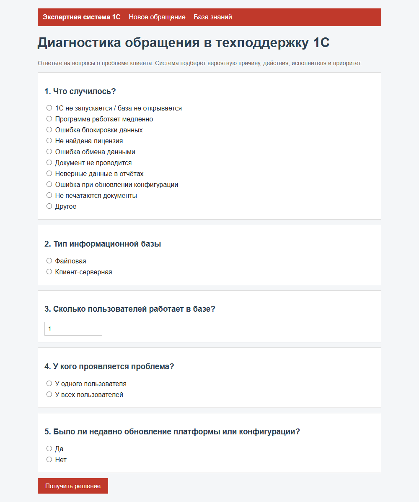
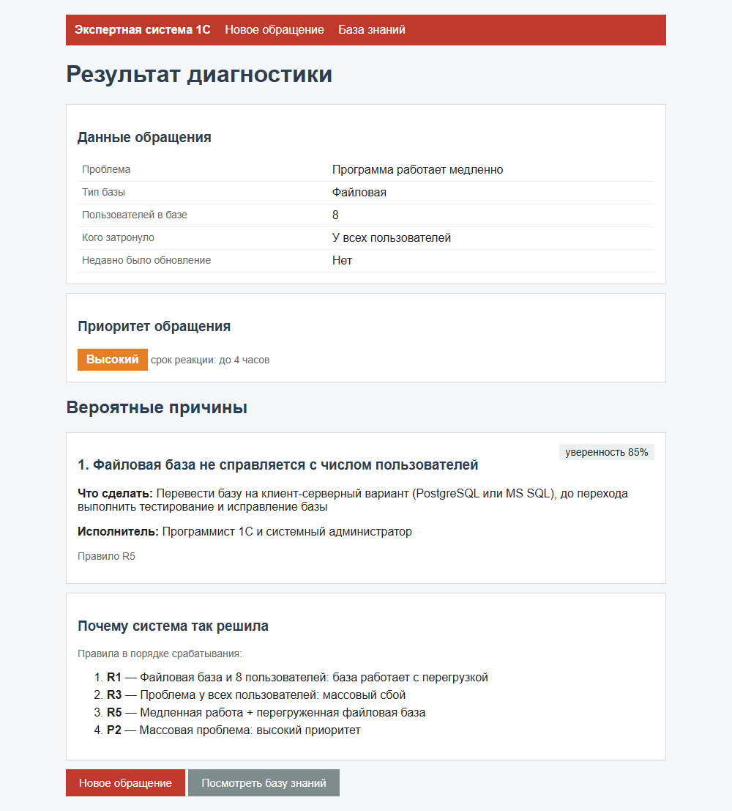

# Диагностика проблем с 1С

Небольшая экспертная система для первой линии поддержки. Форма содержит пять полей: проблема, тип базы, число пользователей, охват проблемы и наличие недавнего обновления. Результат включает возможные причины, действия, исполнителя и приоритет. Для каждого вывода показаны сработавшие правила.

Основа — Flask и CLIPS через `clipspy`. Проверено на Python 3.12. Это учебный прототип для практики в ИП Плющев И.А.

## Запуск

Из этой папки, в PowerShell:

```powershell
python -m venv .venv
.\.venv\Scripts\python.exe -m pip install -r requirements.txt
.\.venv\Scripts\python.exe app.py
```

Открыть [localhost:5000](http://127.0.0.1:5000). Остановить сервер — Ctrl+C.

Тесты:

```powershell
.\.venv\Scripts\python.exe -m pytest -v
```

В наборе 26 тестовых случаев: проверяются обычные обращения, несколько причин сразу, порядок объяснения, неизвестная проблема и неправильный ввод.

## Структура

- `app.py` — страницы и обработка формы.
- `expert.py` — проверяет ввод, передаёт факты в CLIPS и собирает ответ.
- `rules.clp` — шаблоны фактов и 26 правил.
- `templates/` — форма, результат и просмотр базы знаний.
- `test_expert.py` — тесты.
- `screenshots/` — примеры экранов.

Входной факт называется `ticket`. В нём `symptom`, `db-type`, `users`, `scope`, `recent-update`. На выходе получаются промежуточные признаки `sign`, причины `diagnosis`, приоритет `priority` и объяснения `trace`.

R1–R4 выделяют признаки, R5–R21 предлагают причины, P1–P4 выбирают приоритет. D0 срабатывает, если подходящей причины нет. Вывод прямой, от фактов к результату; CLIPS использует Rete. Порядок задаётся через `salience`: признаки, причины, приоритет, затем запасной вариант D0.

Коэффициенты уверенности заданы вручную. Например, 85% у правила — не измеренная точность на настоящих обращениях. Проверка правил на реальных обращениях в проект не входит.

## Примеры диагностики

| Ввод | Ожидается |
|---|---|
| Медленно, файловая база, 8 пользователей, у всех | R5: перегрузка файловой базы; высокий приоритет |
| Не запускается у всех после обновления | R10 и R8; критический приоритет |
| Лицензия не найдена у всех | R11; критический приоритет |
| Неизвестная проблема | D0: передать обращение дальше |
| Ноль, дробное или слишком большое число пользователей | Ошибка ввода, без запуска правил |

Примеры экранов:




Ещё: [ошибка запуска](screenshots/3_result_nostart.png), [неизвестная причина](screenshots/4_result_unknown.png), [база знаний](screenshots/5_knowledge.png).

## Отладка

В `expert.py` оставлена выключенной строка `env.eval('(watch rules)')`. Можно раскомментировать её и посмотреть порядок срабатывания правил в терминале.

Flask по умолчанию работает без отладчика и слушает localhost. Для локальной отладки перед запуском:

```powershell
$env:FLASK_DEBUG = "1"
```

`SECRET_KEY` можно задать через окружение, если нужны постоянные cookie между перезапусками. Иначе ключ создаётся заново при старте.
