# Руководство пользователя «Заметки встреч»

«Заметки встреч» помогает быстро записывать итоги совещаний, собраний, конференций и деловых встреч, а потом находить нужную запись по слову, дате или времени.

## Возможности

| Функция | Как работает |
|---|---|
| Создание заметки | Заголовок, тип мероприятия, дата, время, участники, содержание. Дата и время подставляются текущие |
| Редактирование | Любое поле можно изменить; изменения сохраняются по кнопке «Сохранить» |
| Удаление | С подтверждением, чтобы не удалить случайно |
| Поиск | Одна строка ищет по заголовку, тексту, участникам, дате и времени |
| Фильтр | По типу мероприятия: совещание, собрание, конференция, деловая встреча, другое |
| Хранение | База данных SQLite или отдельные файлы на устройстве, выбирается в настройках |
| Проверка ввода | Без заголовка и с неверной датой или временем заметка не сохранится, приложение подскажет формат |
| Платформы | Веб-демо; общий код для Android и iOS, запуск на устройствах пока не проверен |

## 1. Главный экран

При первом запуске на телефоне список пуст. В веб-версии сразу есть 5 примеров заметок, чтобы было на чём попробовать поиск. Сверху строка поиска и фильтр по типу мероприятия, снизу справа кнопка «+».

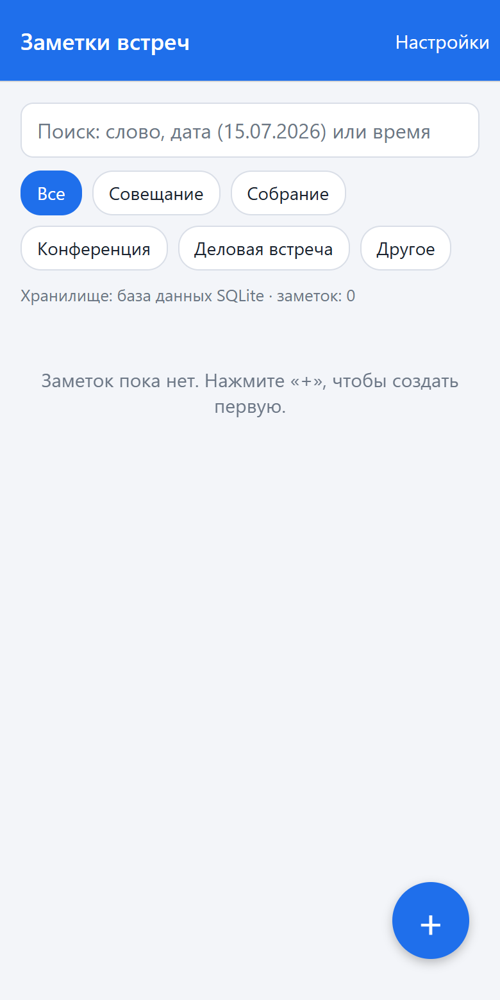 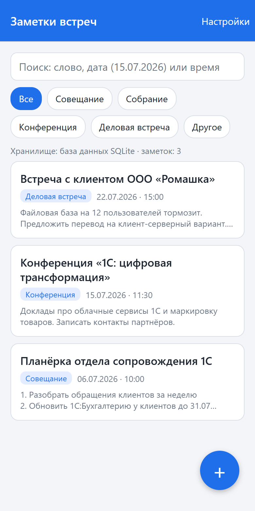

Заметки отсортированы по дате и времени: сверху самые новые. На карточке видно заголовок, тип, дату, время и начало текста. Под фильтром показано, какое хранилище сейчас используется и сколько в нём заметок.

## 2. Создание заметки

1. Нажмите «+».
2. Введите заголовок (обязательное поле).
3. Выберите тип мероприятия.
4. Проверьте дату и время. По умолчанию стоят текущие, их можно исправить. Формат: `ДД.ММ.ГГГГ` и `ЧЧ:ММ`.
5. Укажите участников и запишите содержание: решения, задачи, сроки.
6. Нажмите «Сохранить».

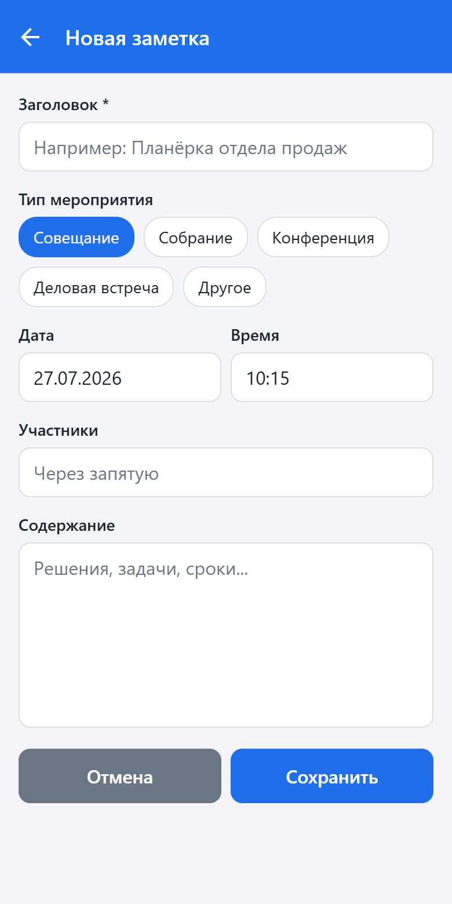 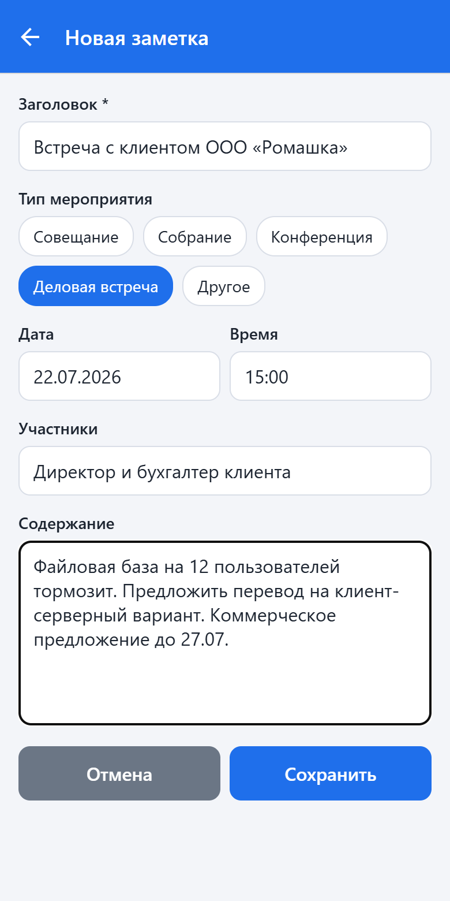

Если заголовок пустой или дата введена неправильно, приложение покажет подсказку и не сохранит заметку:

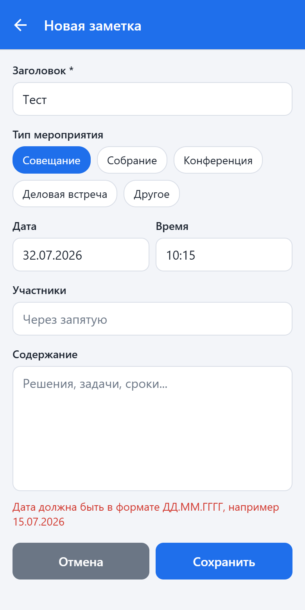

## 3. Поиск и фильтр

Введите в строку поиска:
- слово из заголовка, текста или участников, например `клиент`;
- дату целиком или частично, например `15.07` или `15.07.2026`;
- время, например `15:00`.

Список обновляется сразу при вводе. Регистр букв не важен. Кнопки типов под строкой поиска оставляют только нужные мероприятия, «Все» сбрасывает фильтр. Поиск и фильтр работают вместе.

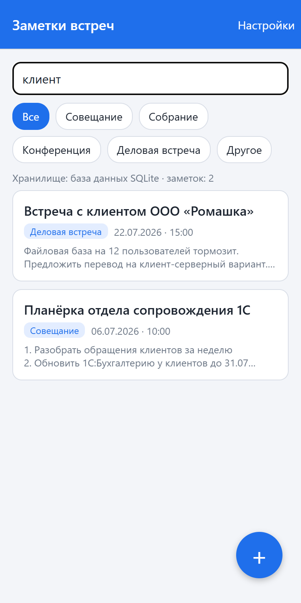 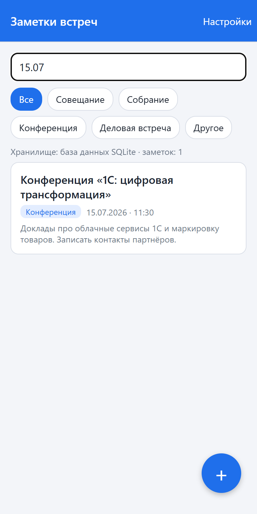 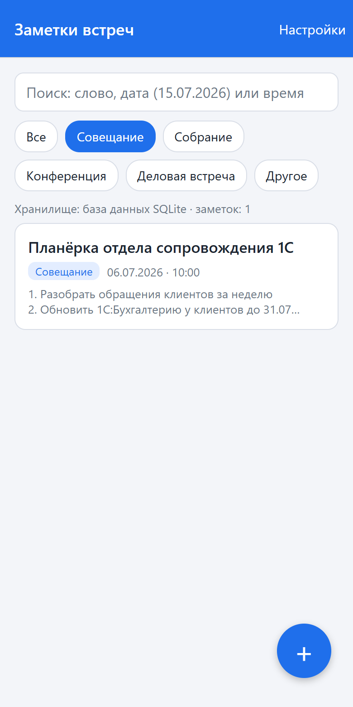

## 4. Просмотр и редактирование

Нажмите на карточку, чтобы открыть заметку целиком. Кнопка «Изменить» открывает ту же форму, что и при создании, с заполненными полями. После сохранения вы вернётесь к заметке.

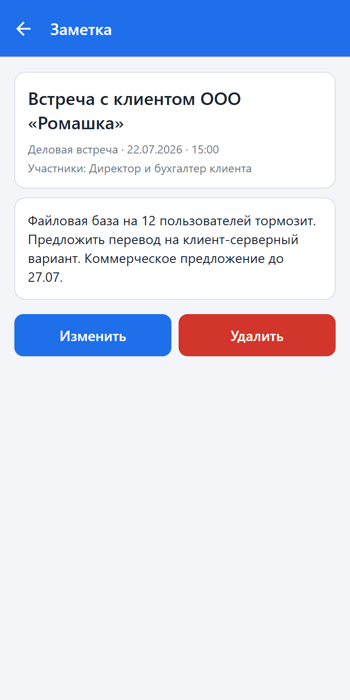 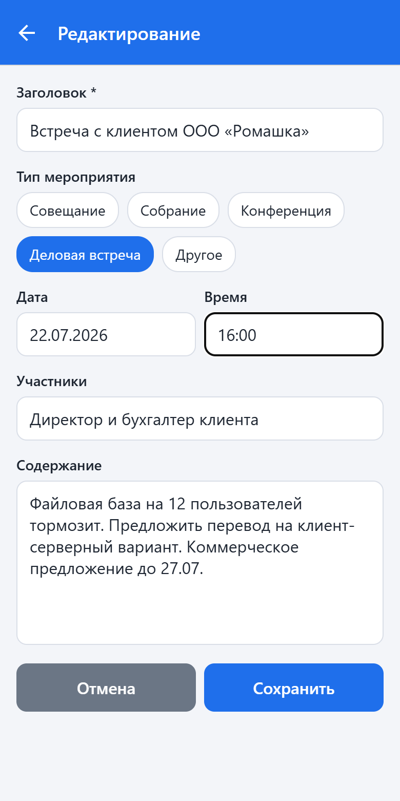 

## 5. Удаление

На экране заметки нажмите «Удалить» и подтвердите действие. Заметка исчезнет из списка.

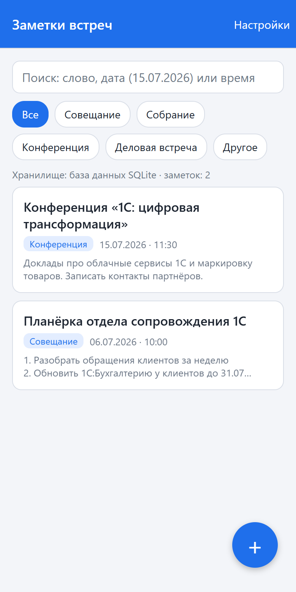

## 6. Настройки: где хранить заметки

Кнопка «Настройки» в правом верхнем углу главного экрана.

- **База данных SQLite** — все заметки в одной локальной базе `notes.db`. Вариант по умолчанию.
- **Файлы на устройстве** — каждая заметка сохраняется отдельным файлом `notes/<номер>.json` в памяти приложения.

Хранилища независимы: после переключения в списке будут заметки выбранного хранилища. В веб-версии оба режима используют localStorage с отдельными ключами; SQLite и JSON-файлы используются только в мобильном приложении.

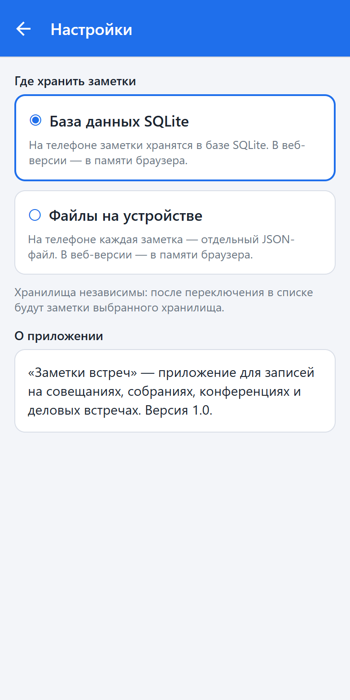 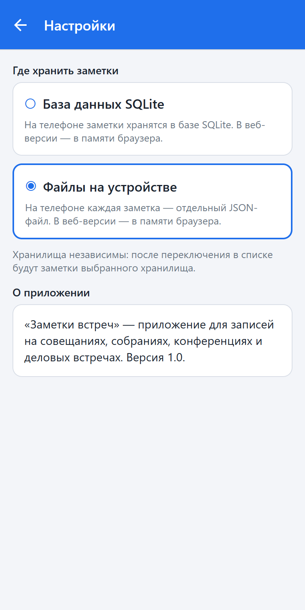 

## 7. Советы

- Записывайте в заголовок, что за встреча и с кем: так её проще найти поиском.
- В содержании удобно вести нумерованный список решений и сроков.
- Для встреч с клиентом используйте тип «Деловая встреча», для планёрок — «Совещание»: фильтр сразу покажет нужные записи.
